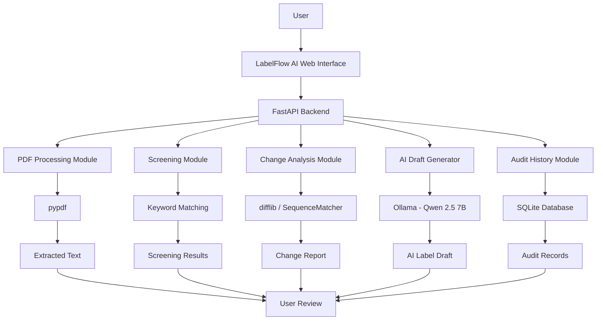
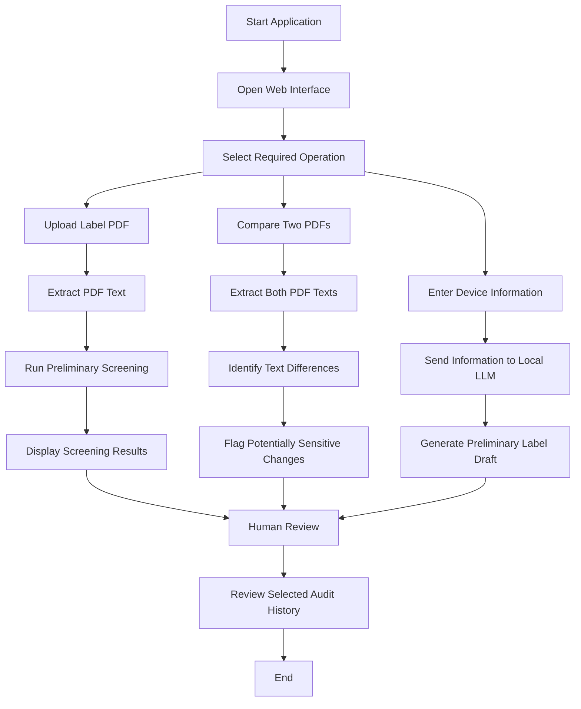

# 🏥 LabelFlow AI
### AI-Powered Medical Device Labeling Management & Compliance Assistance

<p align="center">
  <strong>Analyze • Compare • Generate • Track</strong>
</p>

LabelFlow AI is a prototype application designed to support medical device labeling workflows through PDF text extraction, preliminary label screening, document change analysis, AI-assisted label drafting, and audit history management.

It combines a FastAPI backend, an interactive HTML interface, a local Large Language Model (LLM), and SQLite storage to simplify selected labeling review activities.

> **Disclaimer:** LabelFlow AI is an assistance tool and does not provide regulatory certification, legal compliance determination, or final label approval. All outputs require qualified human review.

---

## 📌 Table of Contents

1. [Project Overview](#-project-overview)
2. [Key Features](#-key-features)
3. [System Architecture](#-system-architecture)
4. [Application Workflow](#-application-workflow)
5. [Technology Stack](#-technology-stack)
6. [Project Structure](#-project-structure)
7. [Installation and Setup](#-installation-and-setup)
8. [Running the Application](#-running-the-application)
9. [API Documentation](#-api-documentation)
10. [Testing](#-testing)
11. [Limitations](#-limitations)
12. [Future Enhancements](#-future-enhancements)

---

## 🎯 Project Overview

Medical device labeling involves managing important product information such as:

- Device identification
- Manufacturer information
- Lot and batch numbers
- Expiry dates
- Unique Device Identification (UDI)
- Warnings and precautions
- Instructions for use
- Storage conditions

Manually reviewing label documents and identifying changes between revisions can be time-consuming.

**LabelFlow AI** provides a prototype workflow to assist users with these activities.

### Main Objectives

- Extract readable text from medical device label PDFs.
- Identify selected label information using preliminary keyword screening.
- Compare original and revised label documents.
- Highlight potentially sensitive changes.
- Generate structured preliminary label drafts using a local AI model.
- Maintain a local history of selected application activities.

---

## ✨ Key Features

### 1. 📄 PDF Text Extraction

Upload a medical device label PDF and extract its text page by page.

**Capabilities:**
- PDF file upload.
- Page-wise text extraction.
- Display extracted content.
- PDF validation and error handling.
- Page count and filename reporting.

**Technology:** Python, FastAPI and pypdf.

### 2. 🛡️ Preliminary Label Screening

Automatically checks extracted text for seven selected label information categories.

| No. | Screening Category |
|---|---|
| 1 | Product or device name |
| 2 | Manufacturer identification |
| 3 | Lot or batch identifier |
| 4 | Expiry or use-by information |
| 5 | Unique Device Identification (UDI) |
| 6 | Warnings or precautions |
| 7 | Instructions for use |

**Output:**
- Number of checks passed.
- Total number of checks.
- Individual check results.
- Review notes for each category.

**Technology:** Python Regular Expressions and keyword matching.

*Note: This is preliminary keyword screening, not regulatory compliance verification.*

### 3. 🔍 Change Impact Analysis

Compare two versions of a medical device label PDF.

**Workflow:**
- Upload the original PDF.
- Upload the revised PDF.
- Extract text from both documents.
- Compare extracted text.
- Identify added, removed and modified content.
- Flag potentially sensitive changes using configured keywords.

**Potentially sensitive keywords include:**
- Warnings and cautions
- Sterility information
- Expiry information
- Lot and batch information
- UDI
- Instructions for use
- Storage conditions
- Dosage
- Manufacturer and model information

**Output:**
- Total changes detected.
- Original text.
- Revised text.
- Change classification.
- Potentially sensitive keyword flags.

**Technology:** Python difflib and SequenceMatcher.

### 4. 🤖 AI-Assisted Label Draft Generation

Generate a structured preliminary medical device label draft using a locally running LLM.

**AI Model:** Qwen 2.5 7B  
**Model Runtime:** Ollama  
**Integration:** OpenAI-compatible Python client.

**User Input:**
- Device name
- Manufacturer
- Model number
- Lot number
- Expiry date
- UDI
- Warnings and precautions
- Instructions for use
- Storage conditions

**AI Capabilities:**
- Organizes provided information into structured sections.
- Uses professional labeling language.
- Preserves supplied warnings and instructions.
- Marks missing information for review.
- Avoids inventing missing product information or regulatory certifications.

**Output:** AI-generated preliminary label draft requiring human verification.

### 5. 🗂️ Audit History Management

Maintains a local record of selected application activities using SQLite.

**Capabilities:**
- Record label draft generation.
- Record PDF comparison activities.
- Store associated filenames and activity details.
- Maintain timestamps.
- Retrieve recent activity records.

**Technology:** SQLite and Python.

*The current implementation is a local audit log and is not tamper-proof.*

### 6. 🌐 Web Interface and REST API

The application provides an HTML-based interface connected to a FastAPI backend.

**Frontend:**
- HTML
- CSS
- JavaScript

**Backend:**
- FastAPI
- Python
- REST API endpoints

**API Documentation:** Interactive Swagger UI.

---

## 🏗️ System Architecture

The following diagram illustrates the major components and their interactions.



### Architecture Components

| Component | Responsibility |
|---|---|
| Web Interface | User interaction and result display |
| FastAPI | Backend processing and API communication |
| pypdf | PDF text extraction |
| Screening Module | Keyword-based label information checks |
| Change Analysis | Text comparison and change classification |
| Ollama | Local LLM execution |
| Qwen 2.5 7B | AI-assisted label draft generation |
| SQLite | Local audit history storage |

---

## 🔄 Application Workflow



---

## 🛠️ Technology Stack

| Category | Technologies |
|---|---|
| Programming Language | Python |
| Backend Framework | FastAPI |
| ASGI Server | Uvicorn |
| PDF Processing | pypdf |
| AI Model Runtime | Ollama |
| Language Model | Qwen 2.5 7B |
| AI Integration | OpenAI-compatible Python client |
| Frontend | HTML, CSS, JavaScript |
| Database | SQLite |
| Text Comparison | difflib |
| Testing | pytest, HTTPX |
| API Documentation | Swagger UI / OpenAPI |

---

## 📁 Project Structure

```text
LabelFlow-AI/
│
├── main.py
│   └── FastAPI backend and application endpoints
│
├── main_backup.py
│   └── Backup backend implementation
│
├── audit_db.py
│   └── SQLite audit database operations
│
├── index.html
│   └── Main application dashboard
│
├── pdf-tool.html
│   └── PDF analysis and labeling interface
│
├── requirements.txt
│   └── Python dependencies
│
├── tests/
│   └── test_api.py
│       └── Automated API tests
│
├── test_ollama.py
│   └── Ollama integration test utility
│
├── .gitignore
│
└── README.md
```

---

## ⚙️ Installation and Setup

### Prerequisites

Install the following software:

1. Python 3.10 or later.
2. Visual Studio Code (recommended).
3. Git.
4. Ollama.
5. Qwen 2.5 7B model.

### Step 1: Clone the Repository

```bash
git clone https://github.com/sharanya-71/LabelFlow-AI.git

cd LabelFlow-AI
```

### Step 2: Create a Virtual Environment

```bash
python -m venv .venv
```

Activate it on Windows:

```powershell
.venv\Scripts\Activate.ps1
```

### Step 3: Install Dependencies

```bash
python -m pip install -r requirements.txt
```

### Step 4: Configure Ollama

Install Ollama and download the required model:

```bash
ollama pull qwen2.5:7b
```

Ensure Ollama is running locally and the model is available.

The application uses:

```text
http://localhost:11434/v1/
```

### Step 5: Start the Backend

```bash
python -m uvicorn main:app --reload
```

The backend will be available at:

```text
http://127.0.0.1:8000
```

---

## 🚀 Running the Application

### Option 1: Web Interface

Open the following file in your browser:

```text
pdf-tool.html
```

Keep the FastAPI backend running while using the interface.

### Option 2: Swagger API Documentation

Open:

```text
http://127.0.0.1:8000/docs
```

Use Swagger UI to explore and test available API endpoints.

### Health Check

```text
http://127.0.0.1:8000/health
```

Expected response:

```json
{
  "status": "healthy"
}
```

---

## 🔌 API Documentation

| Method | Endpoint | Description |
|---|---|---|
| GET | `/` | Backend status |
| GET | `/health` | Health check |
| POST | `/extract-pdf` | Extract text from PDF |
| POST | `/check-compliance` | Preliminary keyword screening |
| POST | `/change-impact` | Compare original and revised PDFs |
| POST | `/generate-label-draft` | AI-assisted label draft generation |
| GET | `/audit-history` | Retrieve saved activity |

All endpoints are implemented in the FastAPI backend.

---

## 🧪 Testing

The project includes automated API tests using pytest and FastAPI TestClient.

Run:

```bash
python -m pytest .\tests\test_api.py -v
```

The current test suite contains six test cases covering:

1. Health endpoint.
2. Preliminary screening.
3. Empty screening input.
4. AI label draft generation.
5. Audit history retrieval.
6. Invalid label draft request.

**Important:** The AI draft generation test requires the local Ollama service and Qwen model to be available.

---

## ⚠️ Limitations

This project is a prototype and has the following limitations:

- Keyword screening does not establish actual regulatory compliance.
- Screening results depend on configured keyword patterns.
- PDF processing extracts selectable text and does not include OCR for scanned documents.
- Change impact analysis compares extracted text only.
- Artwork, visual layout, symbols and barcodes are not compared.
- AI-generated label drafts require expert verification.
- AI output may require correction and validation.
- SQLite audit records are locally stored and are not tamper-proof.
- The prototype does not provide regulatory approval or certification.

**Human review is mandatory before any medical device label is approved or released.**

---

## 🚀 Future Enhancements

Potential future development includes:

- OCR support for scanned PDF documents.
- Advanced regulatory rule validation.
- FDA, EU MDR and applicable regulatory reference integration.
- Visual PDF comparison.
- Barcode and UDI validation.
- Enhanced audit logging and access control.
- Secure document management.
- User authentication and role-based permissions.
- Exporting review reports as PDF.
- Improved AI-assisted document analysis.
- Deployment to a secure cloud environment.

---

## 👨‍💻 Project Information

**Project Name:** LabelFlow AI  
**Domain:** Healthcare Technology / Medical Device Labeling  
**Application Type:** AI-Assisted Document Management Prototype  
**Backend:** FastAPI  
**AI Model:** Qwen 2.5 7B via Ollama  
**Database:** SQLite

---

## 📜 Disclaimer

LabelFlow AI is an experimental software prototype developed for educational and demonstration purposes.

It is not a substitute for qualified regulatory professionals, approved quality management systems, or formal medical device labeling validation.

All generated drafts, screening results and document comparisons must be independently reviewed before practical use.

---

⭐ If you find this project interesting, consider starring the repository!
