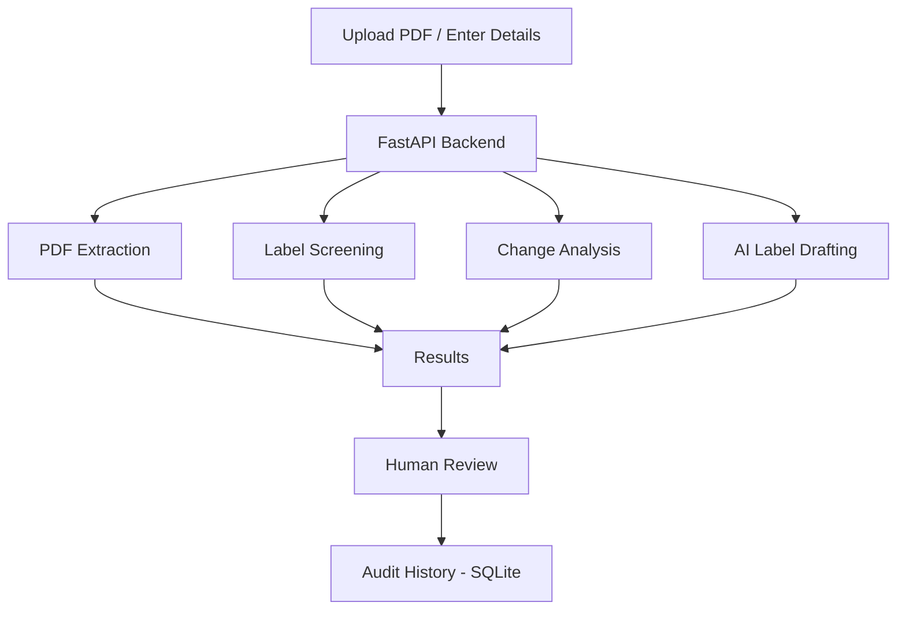

# LabelFlow AI 🏥

LabelFlow AI is a prototype project for managing medical device labeling activities. It helps users extract PDF text, perform preliminary label checks, compare document versions, and generate label drafts using AI.

## Features

- **PDF Text Extraction:** Extract text from PDF documents.
- **Label Screening:** Check important label information.
- **Change Impact Analysis:** Compare two PDF versions and identify changes.
- **AI Label Drafting:** Generate preliminary label drafts using Qwen 2.5 7B.
- **Audit History:** Store application activities using SQLite.

## Workflow



## Technologies Used

Python, FastAPI, HTML, CSS, JavaScript, PyPDF, Ollama, Qwen 2.5 7B, SQLite and pytest.

## Run Locally

```bash
git clone https://github.com/sharanya-71/LabelFlow-AI.git
cd LabelFlow-AI

python -m venv .venv
.venv\Scripts\activate

pip install -r requirements.txt
ollama pull qwen2.5:7b

python -m uvicorn main:app --reload
```

Open `http://127.0.0.1:8000/docs` for API documentation.

## Note

This is a prototype for educational purposes. AI-generated drafts and screening results require human review and do not constitute regulatory approval.

**Thanks for checking out LabelFlow AI!** 
